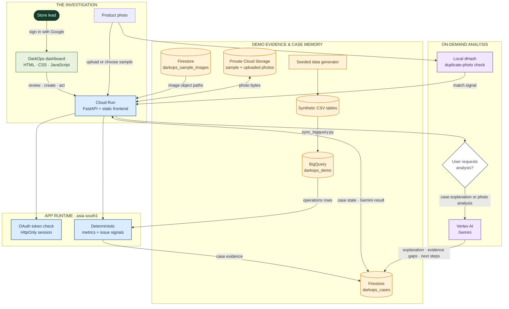

# DarkOps

### Find the signal. Build the case. Learn what changed.

DarkOps is an operations intelligence prototype for quick-commerce dark stores. It turns scattered signals—waste, expiry exposure, stock variance, returns, and product photos—into an investigation a store team can understand and act on.

The demo uses fictional Bengaluru operations data. It brings deterministic calculations together with on-demand Gemini analysis, a photo-forensics workflow, and a recorded follow-up. The aim is to show how a store anomaly can become an evidence-backed case, not to automate real-world decisions without review.

> **Demo data:** DarkOps is not connected to a live retailer or delivery network.

## Video demonstration

[Watch the DarkOps demo on Google Drive](https://drive.google.com/drive/folders/1G_uGXGzAQf1lQUeWw6q_gIrns0Vg-rjO?usp=sharing)

## From signal to follow-up

1. **Spot an unusual pattern.** The dashboard summarizes loss, open cases, waste rate, and stock nearing expiry. Cases link signals to the store and product involved.
2. **Open an investigation.** Review the supporting facts, possible explanations, evidence gaps, and recommended next step.
3. **Bring in a photo.** Analyze a built-in sample or upload a product photo. The forensic view can classify visible damage, read available package details, and compare the image with seeded examples of reused refund photos.
4. **Ask Gemini when it helps.** Request a case explanation or photo analysis. Gemini runs on demand; it does not run on every page load.
5. **Record and revisit.** Record a simulated action and run a simulated seven-day follow-up to see the example workflow through. These are prototype records, not actions sent to a store system.

### What the dashboard measures

| Card | Current calculation |
| --- | --- |
| Loss identified | Sum of the impact amounts on the loaded cases. |
| Open investigations | Loaded cases whose status is not `Verified`. |
| Waste rate | For each store, wasted quantity ÷ (sold quantity + wasted quantity) over the latest seven days; the dashboard averages the store rates. |
| Stock at expiry risk | Units marked at risk within 48 hours multiplied by unit cost, for the latest operations date. |

The figures are calculated by the backend from the synthetic operations dataset and case records. Some supporting card copy and decorative trends are currently demo display values; they are not all calculated from historical comparisons.

## A case file, not a black box

An investigation combines operational measurements with context: case title, product, store, severity and status; evidence and hypotheses; a recommendation; and, when requested, Gemini analysis. The numeric measurements come from the application’s calculations. Gemini is asked to explain the supplied evidence and suggest next steps; it is not the source of truth for the dashboard totals.

For photo forensics, DarkOps checks a local perceptual hash (dHash) index for near-duplicate images, then uses the configured Gemini model for visual analysis when available. If live Gemini is not configured or the call fails, the app has a deterministic scenario fallback. The result labels the engine used, so the demo can distinguish live model output from fallback output.

## The demo’s planted situations

The scenarios are designed to exercise different evidence paths:

1. **A supplier batch goes bad:** produce waste rises while sales remain near baseline.
2. **Stock approaches expiry:** dairy or ready-to-eat items may not sell through before their deadline.
3. **The cold chain breaks:** melted-product complaints can point toward freezer temperature drift or hot, slow delivery routes.
4. **Handling or counts go wrong:** damaged packaging or a cycle-count mismatch creates a stock-variance case.
5. **A refund photo is reused:** perceptual-hash similarity flags seeded duplicate-photo examples for review.
6. **A spike has another explanation:** a demand dip or misleading complaint can act as a red herring, encouraging the reviewer to compare hypotheses with evidence.

These are authored demo cases and seeded data patterns, not automatically verified incidents from real stores.

## Architecture: small, connected, explainable



### Where each piece lives

| Component | Role in this prototype |
| --- | --- |
| **Cloud Run** | Hosts the FastAPI backend and static frontend together. The deployed service scales to zero and is configured with a small instance limit. |
| **BigQuery** | Holds the eight synthetic operations tables: stores, products, daily operations, sales, purchases, wastage, returns, and cycle counts. The API loads these rows and calculates operational metrics. |
| **Firestore** | Stores case workflow records in `darkops_cases`, including fields such as `gemini_investigation`, `forensics`, action records, and status updates. The `darkops_sample_images` collection stores sample image metadata and Cloud Storage object paths. |
| **Cloud Storage** | Holds photo bytes in a private bucket. Sample photos and uploaded investigation photos are served through backend routes; Firestore stores references, not the image bytes. |
| **Vertex AI Gemini** | Provides on-demand case investigation and multimodal photo analysis. The deployed model is configured through environment variables and can be changed without redesigning the data flow. |
| **Google OAuth** | Signs users into the app. The backend validates the Google ID token and maintains the app session in an HttpOnly cookie. OAuth is the sign-in integration, not a store-data source. |
| **Application Default Credentials** | Lets local development use your Google Cloud identity and lets Cloud Run use its dedicated runtime service account. No service-account key file should be committed. |

### Data and trust boundaries

- The seeded generator writes reproducible CSV files. The deployed service is configured to read the synchronized BigQuery dataset; local development uses CSV by default.
- The backend calculates measurements and supplies the evidence sent to Gemini. This keeps metric arithmetic separate from model-generated explanations.
- Case records and image metadata go to Firestore when Firestore is enabled. Photo bytes go to Cloud Storage when a bucket is configured.
- Google sign-in controls access to app routes. The Cloud Run endpoint itself is reachable so a reviewer can open it and start the sign-in flow.
- The app currently has no Pub/Sub event pipeline, Cloud Scheduler jobs, Cloud Trace integration, BigQuery ML model, or Vertex AI Vector Search. Duplicate-photo checks use in-process dHash.

## Run it locally

### Requirements

- Python 3.10 or later
- A terminal
- Optional for Google Cloud features: `gcloud`, access to the `darkops-511815` project, and Application Default Credentials

### Start the app

```bash
python3 -m venv .venv
source .venv/bin/activate
pip install -r backend/requirements.txt
uvicorn backend.app.main:app --reload
```

Open [http://localhost:8000](http://localhost:8000). The API documentation is at [http://localhost:8000/docs](http://localhost:8000/docs).

Google sign-in requires a Web application OAuth client with the exact local JavaScript origin authorized. For local Google Cloud access, create `.env` from `.env.example`, set your own OAuth client ID, then run:

```bash
gcloud auth application-default login
```

Never put a client secret, API key, or service-account key in frontend code or commit it to Git.

### Rebuild the synthetic dataset

```bash
python3 -m data.generator.generate
```

For repeatable data, pin both the seed and the final date:

```bash
python3 -m data.generator.generate --seed 17017 --as-of 2026-10-17
```

## Configure and deploy to Google Cloud

The infrastructure scripts target project `darkops-511815` and region `asia-south1` by default. Review them and confirm the selected project before running commands that create resources or change IAM.

1. **Set up project services and identity.** Configure `GOOGLE_CLOUD_PROJECT`, then run `bash infrastructure/setup_gcp.sh`. It enables the needed APIs, provisions the runtime service account and Firestore database if missing, and grants the service account project-level roles used by the app. Review these IAM grants for your environment.
2. **Load the demo tables.** Run `python -m backend.app.sync_bigquery`. This creates the `darkops_demo` dataset if needed and replaces its eight tables with the generated CSV snapshot.
3. **Put sample photos in Cloud Storage.** Run `bash infrastructure/setup_sample_images.sh`. It creates a private regional bucket if needed, grants the runtime service account read access, uploads demo images, and writes their metadata and object paths into Firestore.
4. **Configure OAuth.** Create a Google OAuth Web application client. Add the exact deployed domain and any local development origins to Authorized JavaScript origins. Set `GOOGLE_OAUTH_CLIENT_ID` in your environment or local `.env`; keep credentials out of Git.
5. **Deploy.** Run `bash infrastructure/deploy_cloud_run.sh`. The script deploys the service with its runtime service account, enables BigQuery and Firestore mode, configures Vertex AI, and prints the Cloud Run URL. Add that exact URL’s origin to the OAuth client in Google Cloud Console.

The app’s key integrations are visible at `GET /api/cloud/status`; `GET /api/cloud/bigquery/tables` lists the BigQuery tables when the service account has access.

## API tour

| Route | Purpose |
| --- | --- |
| `GET /api/overview` | Dashboard metrics; accepts an optional `store` filter. |
| `GET /api/issues` | Search and filter investigation cases. |
| `POST /api/issues` | Create a case manually. |
| `POST /api/issues/from-forensics` | Create a case from a photo-analysis result. |
| `POST /api/issues/{id}/investigate` | Request Gemini case analysis. |
| `POST /api/issues/{id}/action` | Record the demo action. |
| `POST /api/issues/{id}/verify` | Run the simulated follow-up check. |
| `GET /api/forensics/samples` | List photo-forensics samples. |
| `POST /api/forensics/analyze-sample` | Analyze a built-in sample photo. |
| `POST /api/forensics/analyze-upload` | Analyze an uploaded photo. |
| `GET /api/cloud/status` | Report configured cloud integrations and data source. |

## What is live, simulated, or absent?

| Capability | Status |
| --- | --- |
| Operations analytics | Deterministic calculations over synthetic CSV or BigQuery rows. |
| Gemini investigation and photo analysis | Live when Vertex AI or a supported local Gemini credential is configured; on demand. Otherwise, the photo workflow can use a deterministic fallback. |
| Case workflow | The deployed app can persist case fields to Firestore. Without Firestore, state is in process and can reset when the service restarts. |
| Sample and uploaded photos | Stored in Cloud Storage when the bucket is configured; metadata and object paths are in Firestore. Local mode uses bundled files and in-process uploads. |
| Action recording and verification | Simulated demo workflow; does not issue a real refund, inventory adjustment, maintenance request, or supplier debit. |
| Dark-store integration | Not implemented. No live inventory, point-of-sale, delivery, refund, or temperature-sensor system is connected. |
| Duplicate-photo matching | Local perceptual hash comparison against the in-process index; no vector database or cross-service search. |

Gemini calls may incur Vertex AI charges. Cloud Run, BigQuery, Firestore, and Cloud Storage may also incur usage charges under Google Cloud pricing and quotas.

## Repository map

```text
frontend/                 Static dashboard and photo-forensics UI
backend/app/main.py        FastAPI routes, authentication, case workflow
backend/app/data_service.py Synthetic operations data and deterministic metrics
backend/app/forensics.py   Photo analysis and local dHash duplicate checks
backend/app/google_cloud.py BigQuery, Firestore, and Vertex AI adapters
data/generator/            Reproducible synthetic data generator
data/samples/              Generated CSV tables and manifest
infrastructure/             GCP setup, image setup, and Cloud Run deployment scripts
docs/                       Architecture notes
```

## Built for a useful question

When a store’s numbers move, the important question is not only **“what changed?”** It is **“what evidence supports the explanation, what should the team do next, and did the follow-up improve?”** DarkOps is a prototype for making that chain visible—and for keeping measured facts distinct from AI-generated interpretation.
